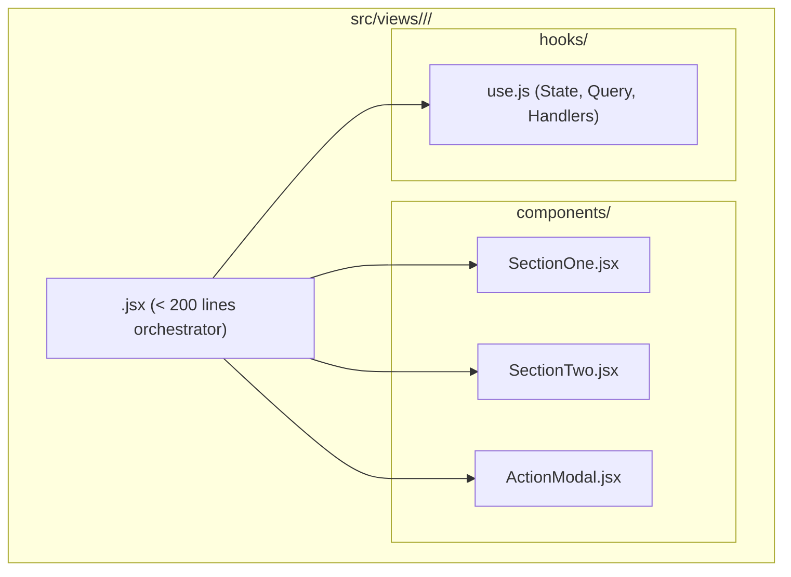
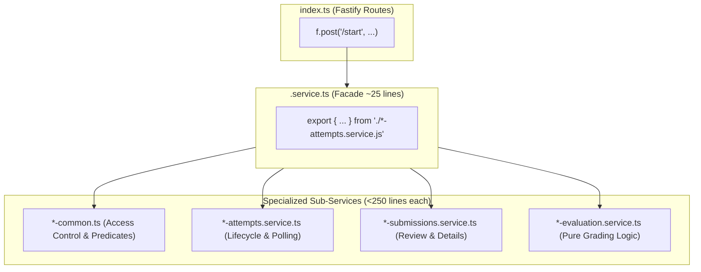

# Gradewise Modularization & Architecture Skill

## When to Use

- Refactoring or creating dashboard views (Admin, Instructor, Student, SuperAdmin)
- Decomposing monolithic frontend views (>200 lines) into subcomponents and custom hooks
- Reusing or extending shared dashboard primitives (`@/components/dashboard/shared/`)
- Reusing or extending shared assessment primitives (`AssessmentActionButtons`, `AssessmentMetadataCard`, `AssessmentLockedNotice`)
- Reusing shared authentication components (`GoogleAuthButton`, `useSignupForm`, `useLoginForm`)
- Decomposing backend Fastify services (>300 lines) into focused sub-services using the **Facade Pattern**
- Consolidating database queries (SQL conditional aggregation, single-query metrics) to prevent sequential round-trips
- Isolating pure business logic (evaluation, grading, matching normalization) into testable modules with Vitest

---

## 1. Frontend View Decomposition Pattern

### Rules
1. **Target Line Count**: Orchestrator views in `src/views/` must stay under **~200 lines**.
2. **Separation of Concerns**:
   - **Orchestrator View (`<ViewName>.jsx`)**: imports the custom hook, maps state to props, and lays out major section components.
   - **Custom Hook (`use<ViewName>.js`)**: encapsulates data fetching (TanStack Query / Zustand), form state (`react-hook-form` / Zod), handlers, and mutations.
   - **Subcomponents (`<ViewName>/components/`)**: pure presentational components receiving typed props/callbacks.



### Folder Convention
```
src/views/<Role>/<Feature>/
├── <Feature>.jsx               # Clean orchestrator (< 200 lines)
├── components/
│   ├── <Feature>Header.jsx     # Header banner, titles, filters
│   ├── <Feature>Stats.jsx      # Stat grid / metric cards
│   ├── <Feature>Table.jsx      # Data table presentation
│   └── <Feature>Modal.jsx      # Dialogs / confirmation modals
└── hooks/
    └── use<Feature>.js         # Encapsulated state and business logic
```

---

## 2. Shared Dashboard Primitives Catalog

Import from `@/components/dashboard/shared/`:

```javascript
import {
  DashboardStatCard,
  DashboardStatGrid,
  DashboardSectionCard,
  DashboardQuickActions,
  StatCardSkeleton,
  TableSkeleton,
  CardListSkeleton,
} from "@/components/dashboard/shared";
```

### `DashboardStatCard`
Reusable metric card with automatic loading skeleton, 6 semantic color variants, trend badges, and accessible typography:
```jsx
<DashboardStatCard
  title="Active Assessments"
  value={activeCount}
  icon={FaFileAlt}
  color="emerald"       // "cyan" | "emerald" | "amber" | "rose" | "purple" | "blue"
  trend="+12% this week" // optional
  subtitle="Total attempts"
  loading={loading}
/>
```

### `DashboardStatGrid`
Responsive grid container handling auto-fit columns:
```jsx
<DashboardStatGrid columns={4}>
  <DashboardStatCard ... />
  <DashboardStatCard ... />
  <DashboardStatCard ... />
  <DashboardStatCard ... />
</DashboardStatGrid>
```

### `DashboardSectionCard`
Glassmorphic container card with header, title (`text-wrap: balance`), icon badge, and action button slot:
```jsx
<DashboardSectionCard
  title="Recent Assessments"
  description="Manage and review latest created assessments"
  icon={FaClipboardList}
  action={
    <Button variant="primary" onClick={handleCreate}>
      New Assessment
    </Button>
  }
>
  <TableContent />
</DashboardSectionCard>
```

### `DashboardQuickActions`
Accessible launcher grid with $\ge 44\text{px}$ touch targets:
```jsx
const actions = [
  { label: "New Assessment", href: "/instructor/assessments/create", icon: FaPlus, color: "emerald" },
  { label: "Upload Resource", href: "/instructor/resources", icon: FaUpload, color: "cyan" },
];

<DashboardQuickActions actions={actions} />
```

---

## 3. Shared Assessment Primitives

Import from `@/views/Instructor/AssessmentManagement/components/`:

### `AssessmentActionButtons`
Unified action buttons supporting both table chips and card grid layouts:
```jsx
<AssessmentActionButtons
  assessment={assessment}
  mode="chips"           // "chips" (table rows) | "grid" (mobile / card list)
  onClone={handleClone}
  onDelete={handleDelete}
  onPreview={handlePreview}
  onAnalytics={handleAnalytics}
  onEnroll={handleEnroll}
  onPaper={handlePaper}
  isCloning={isCloning}
/>
```

### `AssessmentMetadataCard`
Consolidates Title input, Language selector (with dynamic RTL awareness), and AI instruction prompt:
```jsx
<AssessmentMetadataCard
  title={title}
  setTitle={setTitle}
  language={language}
  setLanguage={setLanguage}
  prompt={prompt}
  setPrompt={setPrompt}
  disabled={isLocked}
/>
```

### `AssessmentLockedNotice`
Renders a prominent warning banner when `isExecuted === true`, disabling inputs and providing CTAs to "Clone Assessment" or "View Analytics":
```jsx
{isExecuted && (
  <AssessmentLockedNotice
    assessmentId={id}
    onClone={handleClone}
    isCloning={isCloning}
  />
)}
```

---

## 4. Shared Auth Primitives

- **`GoogleAuthButton`** (`@/components/auth/GoogleAuthButton.jsx`): Reusable Google OAuth button with spinner state and design token styling (`btn.secondary` / Google icon).
- **`useLoginForm`** (`@/hooks/useLoginForm.js`): Manages login credentials, validation, captcha verification, and role redirect.
- **`useSignupForm`** (`@/hooks/useSignupForm.js`): Manages signup form fields, Zod validation (`signupSchema`), recaptcha token generation, and Firebase redirect listeners.

---

## 5. Backend Service Decomposition (Facade Pattern)

### Problem
Monolithic backend services (`assessments.service.ts`, `student-assessments.service.ts`) growing to 400–900 lines become brittle, difficult to test, and create merge conflicts.

### Solution
Decompose the monolith into focused, single-responsibility files while retaining the original service file as a **lightweight facade re-exporting all functions**. This preserves **100% backward compatibility** with route handlers.



### File Responsibilities
1. **`*-common.ts`**: Pure access control predicates, ownership checks, and immutability assertions (`verifyAssessmentOwner`, `assertNotExecuted`).
2. **`*-<operation>.service.ts`**: Domain operations interacting with PostgreSQL / Drizzle (e.g. `startAssessmentService`, `submitAssessmentService`).
3. **`*-evaluation.service.ts`**: Pure algorithmic logic free from database I/O (`evaluateAnswer`, `normalizeMatchPairs`).
4. **`<domain>.service.ts`**: Pure facade re-exporting all sub-services.

---

## 6. Database Query Consolidation

### Anti-Pattern (Sequential Unindexed Queries)
```typescript
// BAD: 4-6 sequential queries causing database latency
const total = await db.select({ count: count() }).from(assessments);
const executed = await db.select({ count: count() }).from(assessments).where(eq(assessments.isExecuted, true));
const attempts = await db.select({ count: count() }).from(assessmentAttempts);
const avgScore = await db.select({ avg: avg(assessmentAttempts.score) }).from(assessmentAttempts);
```

### Pattern (SQL Conditional Aggregation & Joins)
```typescript
// GOOD: Consolidated into single round-trips
const [assessmentMetrics] = await db
  .select({
    total: count(assessments.id),
    executed: count(sql`CASE WHEN ${assessments.isExecuted} THEN 1 END`),
  })
  .from(assessments)
  .where(eq(assessments.instructorId, instructorId));

const [attemptMetrics] = await db
  .select({
    totalAttempts: count(assessmentAttempts.id),
    avgScore: avg(assessmentAttempts.score),
  })
  .from(assessmentAttempts)
  .innerJoin(assessments, eq(assessmentAttempts.assessmentId, assessments.id))
  .where(eq(assessments.instructorId, instructorId));
```

---

## 7. Quality Gates & Verification

Whenever modularizing or refactoring code:

1. **Backend Verification** (`grade-wise-ai-backend-fastify`):
   ```bash
   npm run typecheck && npm test && npm run build
   ```
   - Must pass with 0 type errors.
   - All Vitest test suites must pass (target: 100% pass rate).
   - Compiled `dist/` must be clean.

2. **Frontend Verification** (`grade-wise-ai-frontend-next`):
   ```bash
   npm run lint && npm run build
   ```
   - Must pass ESLint with 0 errors and 0 warnings.
   - All 27 Next.js App Router routes must compile cleanly with Turbopack.
